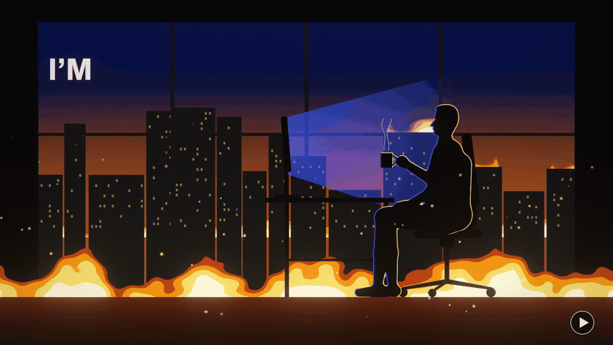
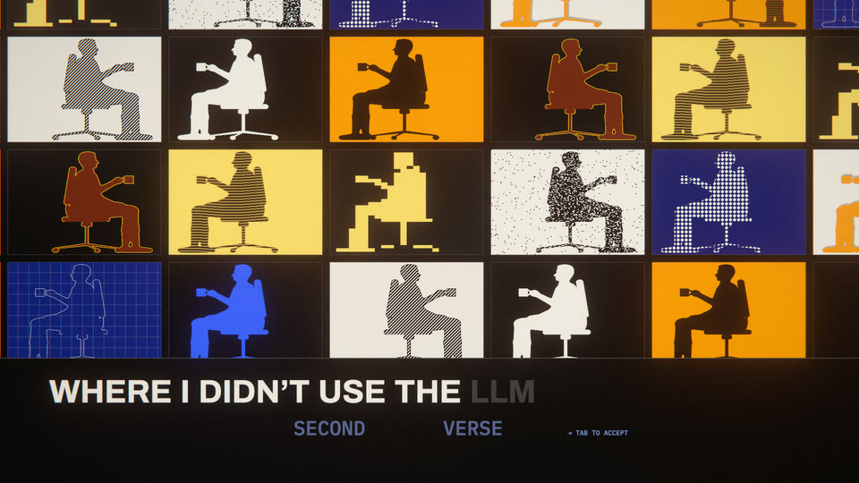
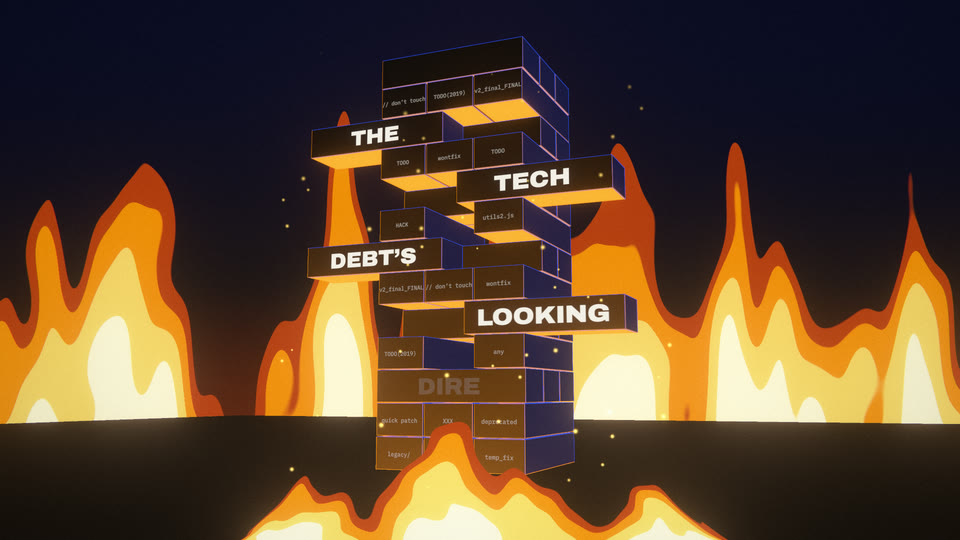
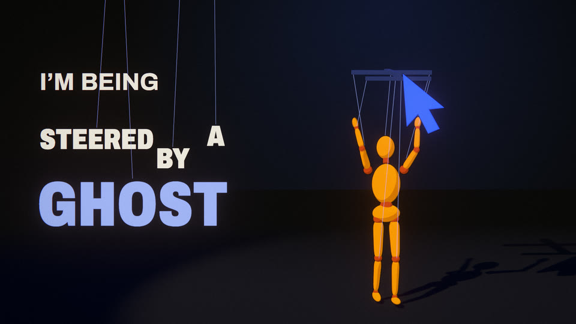
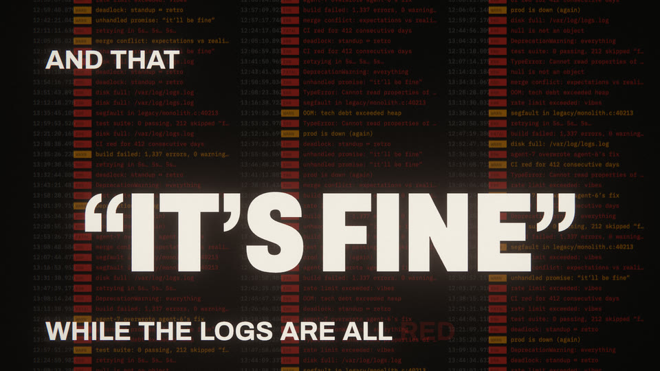
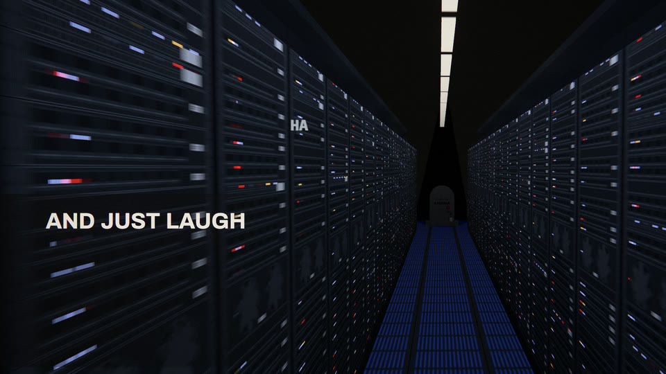
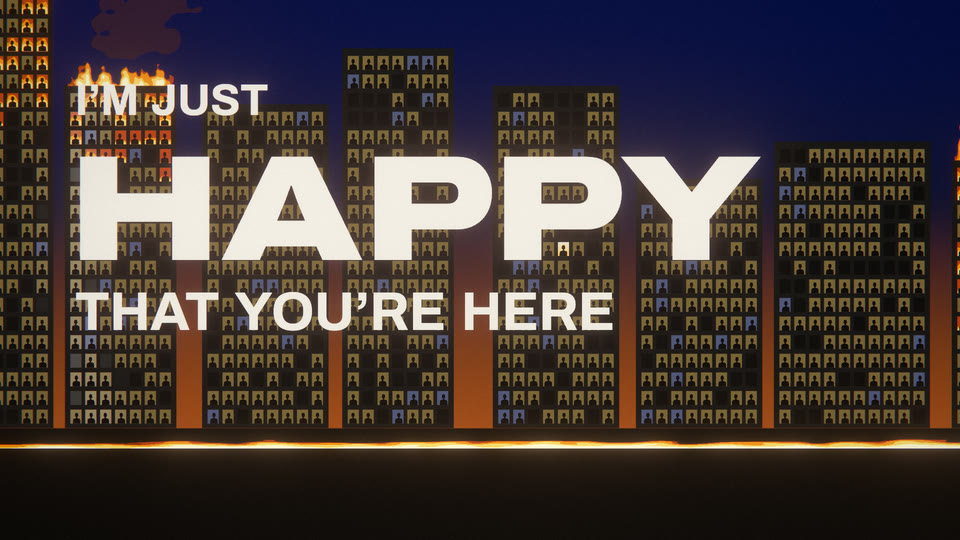

# I'm So Happy To Be Here

[](https://youtu.be/yUanJ62cOZo)

Yet another **AI-generated music video rendered entirely in code.**

Greatly inspired by [mexicat/pdoom-video](https://github.com/mexicat/pdoom-video) by Giacomo Magnanini, whose engine this video partially builds on.

The video was generated with Claude Code (Opus 5.5). Every frame is a deterministic function of song time. The same TypeScript + three.js code runs the live preview in the browser and the offline 4K export, and every word lands on screen exactly when it's sung.

The song "I'm So Happy To Be Here" itself was also AI-generated, using [Suno](https://suno.com) with lyrics loosely inspired by Wookiefoot.

**▶ [Watch it on YouTube](https://youtu.be/yUanJ62cOZo)**

## Gallery

| | |
|---|---|
|  |  |
|  |  |
|  |  |

## How it works

The video is a web app: TypeScript with three.js (WebGL) and GLSL shaders for the 3D and effects, Canvas2D and opentype.js for the type, Bun and Vite to run it, and headless Chrome (driven by Playwright) piping frames into ffmpeg for the export.

1. **Timing data** (`data/`). Beats, downbeats, sections, drum and vocal onsets, loudness envelopes and word-level lyric timings, all precomputed from the song (99.4 BPM, so one bar is about 2.42 s). The analysis tools that produce this format can be found in [pdoom-video](https://github.com/mexicat/pdoom-video).
2. **The edit** (`app/src/timeline.ts`). Scene boundaries are defined by lyric lines ("cut on the last beat before *Still I know*") and snapped to the beat grid, never hard-coded to times. Change the timing data and the edit follows.
3. **The scenes** (`app/src/scenes/`). There's one module per scene, and each renders any time `t` from scratch: three.js for 3D, GLSL shaders for fire and light, and Canvas2D for type. Randomness is seeded, so the same `t` always gives the same frame.
4. **Post and export** (`app/src/engine/`, `app/scripts/`). Bloom, halation, grain and vignette are added on top. For motion blur, each exported frame averages up to 324 sub-frames. Headless Chrome streams raw frames to ffmpeg, at 1080p or true 4K (every layer rendered at 3840×2160, not upscaled).

The concept, look and a scene-by-scene breakdown are in [`docs/TREATMENT.md`](docs/TREATMENT.md). The engine and scene API are documented in [`docs/ENGINE.md`](docs/ENGINE.md).

## Layout

```
app/
  src/engine/     renderer core: playback, post, typography, HUD, audio and lyric queries
  src/scenes/     one module per scene, plus shared look/figure helpers (_look, _human, _toon)
  src/timeline.ts the edit
  scripts/        render.ts (stills, contact sheets, video), chunked.ts (memory-safe 4K export)
  public/         fonts and images (see FONTS.md and ASSETS.md there)
audio/happy.mp3   the song
data/             the timing data the renderer reads (audio.approx.json, lyrics.approx.json)
song/             lyrics (with voice tags) and notes on the song
docs/             treatment, engine guide, README images
```

## Run it

You need [bun](https://bun.sh), Google Chrome (the export drives it headless through playwright-core) and ffmpeg with libx264.

### Preview

```bash
cd app && bun install && bunx vite
```

Open http://localhost:5173. Add `?t=160` to start at a given time, or `&scale=2` for 4K.

| Key | Action |
|---|---|
| space | play / pause |
| ← / → | seek ±1 s (±5 s with shift) |
| `,` / `.` | step one frame |
| `[` / `]` | previous / next scene |
| `l` | loop the current scene |
| `h` | hide the UI |

### Stills and contact sheets

```bash
cd app && bun scripts/render.ts stills --t 162.7 --samples 12 --out ../out/stills
```

```bash
cd app && bun scripts/render.ts sheet --from 160 --to 172 --n 12 --cols 4 --out ../out/sheet.png
```

### The video

1080p60:

```bash
cd app && bun scripts/render.ts video --samples auto --out ../out/happy-to-be-here.mp4
```

4K, rendered in chunks so headless Chrome only loads the scenes each chunk needs (all of them at 4K would take many GB):

```bash
cd app && bun scripts/chunked.ts --scale 2 --fps 30 --samples auto --audio ../audio/happy.mp3 --out ../out/happy-to-be-here-4k.mp4
```

The export doesn't run in real time. `--samples 4` gives a quick draft, and `--from`/`--to` render part of the song.

## Credits

- **Inspiration and engine:** [mexicat/pdoom-video](https://github.com/mexicat/pdoom-video) by Giacomo Magnanini, the code-rendered music video that inspired this one. Its renderer and export script are reused here under the MIT License. It's worth watching.
- **Fonts:** Archivo, Cormorant Garamond, IBM Plex Mono, and the EMS and Hershey stroke fonts. See [`FONTS.md`](app/public/fonts/FONTS.md).
- **Images:** see [`ASSETS.md`](app/public/assets/ASSETS.md). Everything else is drawn in code.

## License

- **Code:** [MIT](LICENSE), including the parts reused from pdoom-video, which keep their original copyright notice.
- **The song, lyrics and video:** [CC BY-NC 4.0](https://creativecommons.org/licenses/by-nc/4.0/). Share and remix them for non-commercial purposes, with credit: *"I'm So Happy To Be Here" by Josef Goldstein (lyrics; music made with Suno), CC BY-NC 4.0.*
- **Fonts and images:** their own licences, listed in `FONTS.md` and `ASSETS.md`.

See [`LICENSE`](LICENSE) for the full terms.
